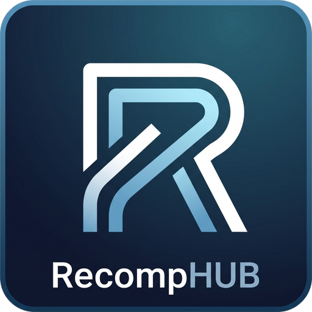

<p align="center">
  
</p>

<h1 align="center">RecompHUB</h1>

<p align="center">
  <b>O jeito mais fácil de jogar jogos descompilados e recompilados no PC.</b><br/>
  Escolha o jogo, aponte a sua ISO/ROM e clique em <b>JOGAR</b>.
</p>

<p align="center">
  
  
  
</p>

---

## 💙 Créditos

Todo o catálogo de jogos do RecompHUB vem do **[PortsDR.com](https://portsdr.com/)**, criado e mantido por **TinSoldier97**.
O PortsDR é quem reúne e organiza todos esses ports da comunidade. Sem esse trabalho o RecompHUB não existiria. Visite o site e apoie o criador!

Os ports em si pertencem aos seus respectivos autores e projetos (N64Recomp, XenonRecomp, PS2Recomp, Ship of Harkinian, OpenGOAL e muitos outros). O RecompHUB apenas baixa as releases oficiais diretamente do GitHub de cada projeto.

---

## 🎮 O que é o RecompHUB?

Existem dezenas de jogos clássicos (N64, PS1, PS2, Xbox 360…) que a comunidade transformou em **versões nativas para PC**. O problema é que cada um tem um jeito diferente de instalar: baixar do GitHub, descompactar, colocar a ROM com um nome específico, rodar um extrator, configurar…

O RecompHUB faz tudo isso por você, com uma interface parecida com a da Steam.

## ✨ O que ele faz

- **Catálogo sempre atualizado**: a lista de jogos é puxada automaticamente do PortsDR.com. Jogo novo no site = jogo novo no app.
- **Instalação em 1 clique**: baixa a versão mais recente do jogo direto do GitHub oficial do projeto, já escolhendo a versão certa para o seu sistema.
- **Use a sua própria ISO/ROM**: você escolhe onde está o arquivo do seu jogo. Pode ser a ISO/ROM direto **ou um arquivo compactado (.zip, .7z, .rar)** com ela dentro. O app descompacta sozinho.
- **Reconhece a ROM certa**: o app confere o arquivo (hash SHA-1) para saber se é a ROM certa, mesmo que o nome esteja diferente.
- **Configura tudo sozinho**: coloca a ROM com o nome que o jogo espera, ativa o modo portátil (saves ficam na pasta do jogo), roda extratores de assets quando necessário, etc.
- **Jogos de Windows no Linux**: se o port só tem versão para Windows, o RecompHUB roda automaticamente com Proton / `umu-run`, sem precisar adicionar na Steam.
- **Barra de progresso nos Downloads**: download, descompactação e instalação aparecem na aba Downloads, mesmo trocando de página.
- **Tela cheia**: botão para ativar/desativar tela cheia nos jogos que suportam (ex.: Ace Combat 5).
- **Desinstalar de verdade**: ao excluir um jogo você pode escolher apagar também a ISO/ROM do seu computador, para não ficar ocupando espaço escondido.

## ⚠️ Importante sobre ISOs e ROMs

O RecompHUB **não baixa e nunca vai baixar ISOs ou ROMs**. Você precisa ter a sua própria cópia original do jogo. Todos os ports precisam desse arquivo para funcionar.

---

## 📥 Como instalar

Baixe a versão mais recente na aba **[Releases](https://github.com/ArthurxD232/RecompHUB/releases)**.

### Linux
- **AppImage** (recomendado):
  ```bash
  chmod +x RecompHUB-beta-0.1-linux-x86_64.AppImage
  ./RecompHUB-beta-0.1-linux-x86_64.AppImage
  ```
- **tar.gz**: descompacte e rode `./recomphub`.
- Para jogos que só têm versão Windows, instale o **umu-launcher** (`umu-run`) ou tenha o **Proton** instalado pela Steam.

### Windows
- **Portable (.exe)**: é só abrir.
- **.zip**: descompacte e abra `RecompHUB.exe`.

## 🕹️ Como usar

1. Abra o **Catálogo** e escolha um jogo.
2. Clique em **Instalar** e indique onde está a ISO/ROM (ou o .zip com ela).
3. Acompanhe pela aba **Downloads**.
4. Quando aparecer **JOGAR**, é só clicar. 🎉

Dica: em **Configurações** você pode definir uma pasta com todas as suas ISOs/ROMs, e o app encontra sozinho a certa para cada jogo.

---

## 🛠️ Para desenvolvedores

Feito com Electron + React + TypeScript + Tailwind CSS.

```bash
npm install
npm run dev          # modo desenvolvimento
npm run build        # compila
npm run dist:linux   # gera AppImage + tar.gz em ./release
npm run dist:win     # gera .zip + portable .exe em ./release
```

Estrutura principal:

```
src/
├── main/       # Processo principal (catálogo, downloads, cofre de ROMs, receitas, execução)
├── preload/    # Ponte segura entre interface e sistema
├── renderer/   # Interface React (estilo Steam)
└── shared/     # Tipos compartilhados
```

## 🐞 Status

Esta é uma versão **beta**. Alguns jogos podem precisar de ajustes. Encontrou um problema? Abra uma **[Issue](https://github.com/ArthurxD232/RecompHUB/issues)** dizendo qual jogo, seu sistema e o que aconteceu.

## 📄 Licença

MIT. O RecompHUB não é afiliado ao PortsDR, à Valve, nem a nenhuma empresa dona dos jogos.
